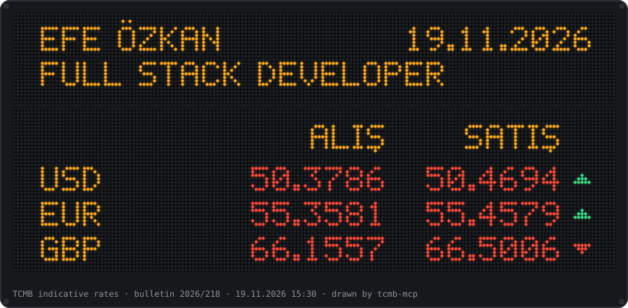

Full stack developer. I build web apps with Next.js, React and TypeScript, usually with Go and PostgreSQL on the backend.

The board above is redrawn every weekday after the Central Bank's 15:30 bulletin, using [tcmb-mcp](https://github.com/efeozkanw/tcmb-mcp), my MCP server for Turkish exchange rates.

### Stack

### Projects

- **[tcmb-mcp](https://github.com/efeozkanw/tcmb-mcp)**: MCP server for the daily exchange rates of the Central Bank of the Republic of Türkiye. Handles weekends, holidays and the invoice-date rule, and draws the board at the top of this page.  
- **[efe.bio](https://efe.bio)**: my personal site.

### Recent releases

- [tcmb-mcp v0.1.0](https://github.com/efeozkanw/tcmb-mcp/releases/tag/v0.1.0), 2026-11-19

### Contact

 
